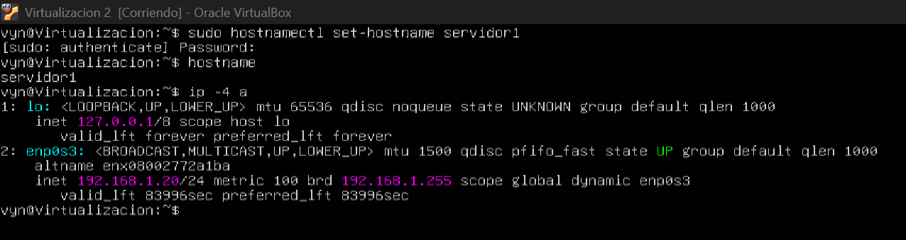
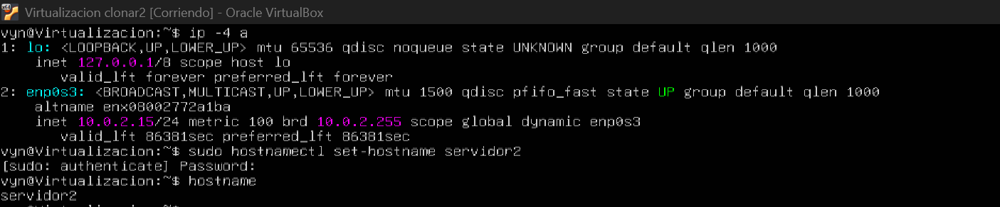
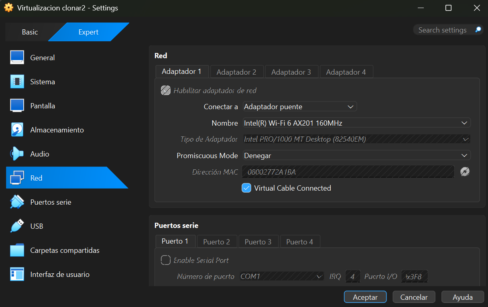
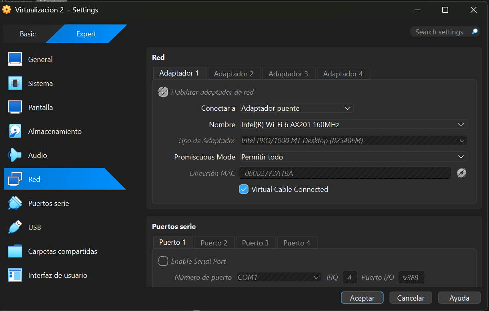

# Homework 02 - Communication Between Virtual Servers

## Evidence

### 1. Server 1 Hostname

The following screenshot shows the hostname configured for the first virtual server.

### 2. Server 2 Hostname

The following screenshot shows the hostname configured for the second virtual server.

---

### 3. Initial Network Configuration

### 4. Updated Network Configuration

The following screenshot shows the network configuration after assigning a different IPv4 address to the second virtual server, ensuring that both servers have unique IP addresses within the same subnet.

### 5. Server 1 IP Configuration

The following screenshot shows the final IPv4 configuration of the first virtual server.

### 6. Connectivity Test: Server 1 to Server 2

The following screenshot shows a successful ping test from Server 1 to Server 2.

### 7. Connectivity Test: Server 2 to Server 1

The following screenshot shows a successful ping test from Server 2 to Server 1.

