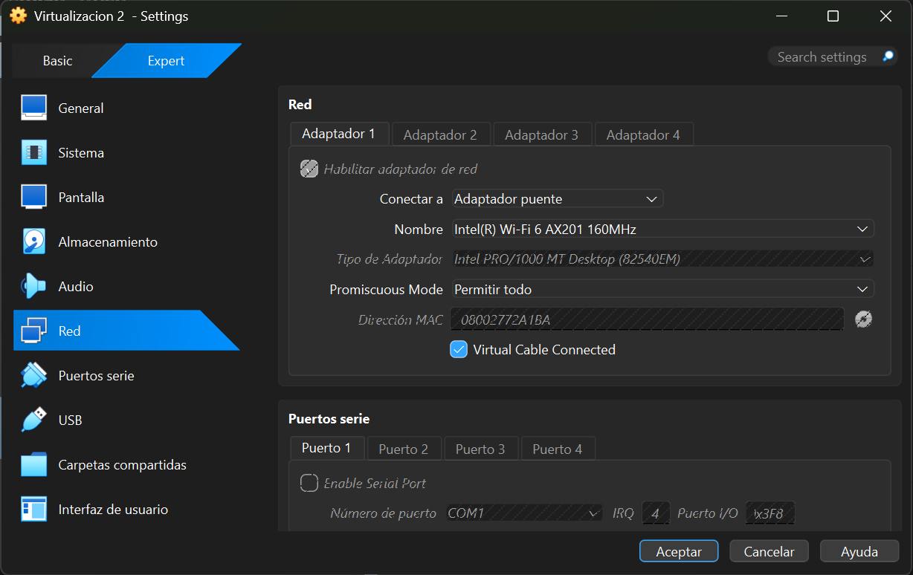

# Homework 01 - Network Configuration

## Evidence

### 1. Local Host IP Address

The following screenshot shows the network configuration of the local host (Windows), including its IPv4 address, subnet mask, and default gateway.

### 2. Virtual Machine IP Address

The following screenshot shows the IPv4 configuration of the Ubuntu virtual machine using the `ip -4 a` command. The virtual machine was configured with an IP address in the same subnet as the host machine.

### 3. Connectivity Test

The following screenshot shows the connectivity test performed from the Ubuntu virtual machine to the local host using the `ping` command.

### 4. Configuration

The following screenshot shows the configuration of the virtual machine using adaptator briege

