# Kubernetes Monitoring and Centralized Logging


All monitoring components run in the `monitoring-vyll` namespace. The four application workloads run in the `parcial-vyll` namespace.

Grafana and Prometheus are exposed through Traefik using the LoadBalancer IP provided by MetalLB and local DNS entries.


## Architecture

1. Prometheus collects metrics from the Kubernetes cluster and configured targets.
2. Promtail collects container logs and forwards them to Loki.
3. Loki stores the collected logs and makes them available for queries.
4. Grafana uses Prometheus and Loki as data sources.
5. Traefik routes browser requests to Grafana and Prometheus using local domain names.
6. MetalLB provides the external IP address used by Traefik.


##  Kubernetes Cluster and Namespaces

The project uses the Minikube cluster configured in the previous activity, including Traefik and MetalLB.

The following namespaces separate application workloads from monitoring services:

| Namespace | Purpose |
|---|---|
| `monitoring-vyll` | Prometheus, Loki, Promtail, and Grafana |
| `parcial-vyll` | Four application workloads |

Verification commands:

```bash
minikube status
kubectl get nodes -o wide
kubectl get namespaces
```

### Cluster and Namespace Evidence

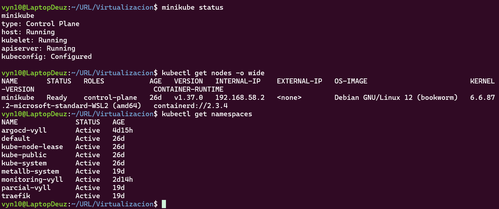

## Installing the Monitoring Stack

Helm is used to install and manage the monitoring components. Their configuration files are maintained in the repository.

### Prometheus

Prometheus collects and stores time-series metrics from the Kubernetes cluster and its configured monitoring targets.

Configuration file: `monitoring/prometheus/values.yaml`

Verification commands:

```bash
kubectl get pods -n monitoring-vyll
kubectl get services -n monitoring-vyll
```

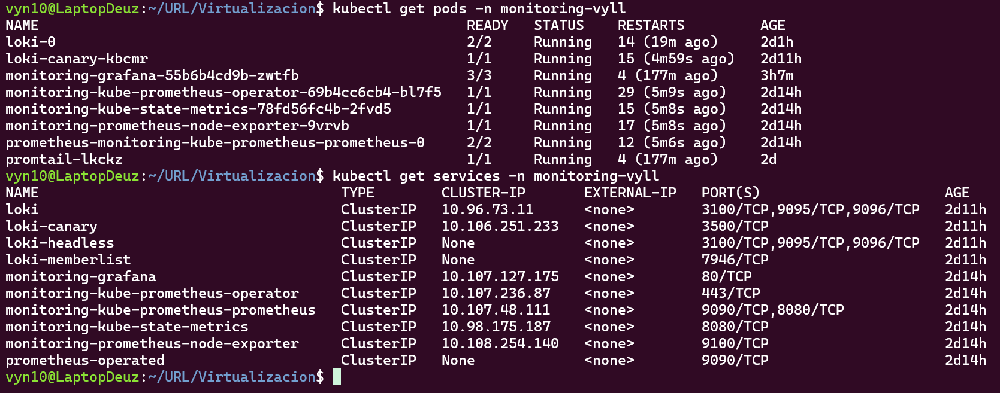

### Loki

Loki provides centralized log storage. It receives logs forwarded by Promtail and allows Grafana to query them.

Configuration files:

- `monitoring/loki/values.yaml`
- `monitoring/loki/loki-kubectl.yaml`

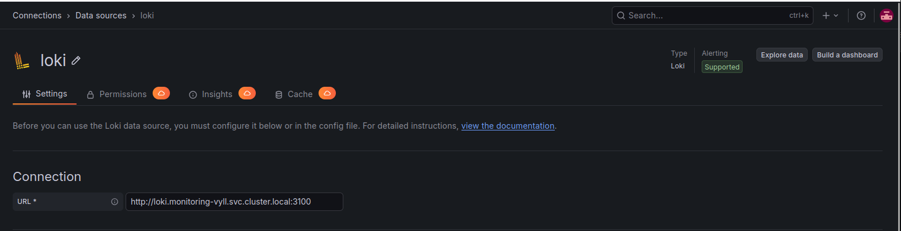

### Promtail

Promtail runs as a DaemonSet to collect container logs from Kubernetes nodes and forward them to Loki.

Configuration file: `monitoring/promtail/values.yaml`

The collection configuration includes logs from the four applications in `parcial-vyll` and from Traefik.

Verification commands:

```bash
kubectl get daemonsets,pods -n monitoring-vyll
kubectl get pods -n parcial-vyll
```

### Grafana

Grafana provides dashboards for cluster metrics and centralized application logs.

Configuration files:

- `monitoring/grafana/values.yaml`
- `monitoring/grafana/datasources.yaml`
- `monitoring/grafana/dashboards.yaml`
- `monitoring/grafana/provisioning-configmap.yaml`

Dashboard definitions are stored as JSON files under `monitoring/grafana/dashboards/`.

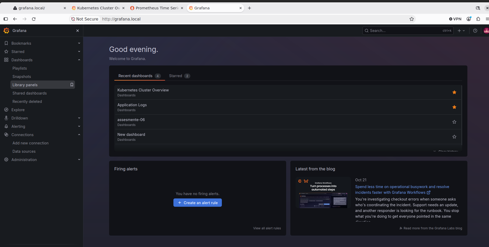

## Grafana Data Sources as Code

Grafana is configured to use Prometheus and Loki through provisioning files stored in the repository.

Configuration file: `monitoring/grafana/datasources.yaml`

| Data source | Type | Purpose |
|---|---|---|
| Prometheus | Prometheus | Kubernetes and application-related metrics |
| Loki | Loki | Centralized container logs |

The data sources are configured through code instead of relying exclusively on manual creation in the Grafana interface.

### Prometheus Data Source

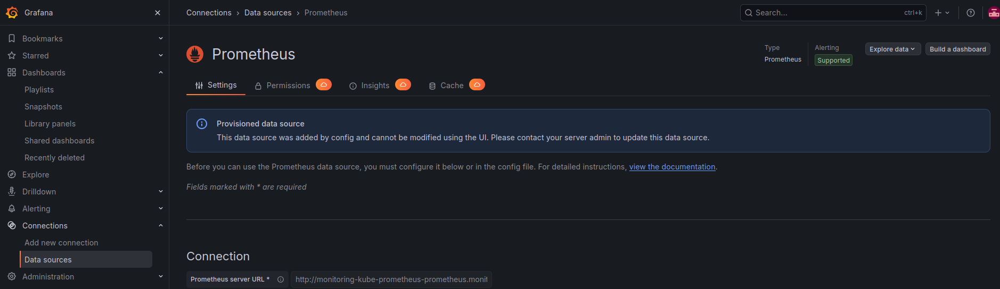

### Loki Data Source


### Provisioning Configuration

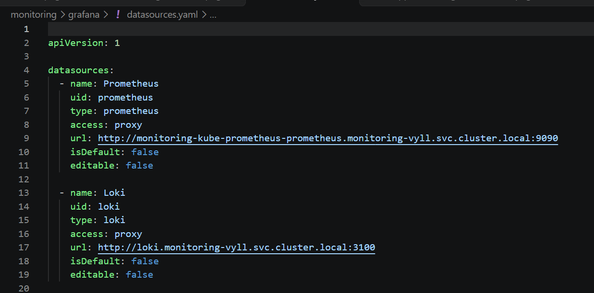

## Grafana Dashboards

### Kubernetes Cluster Overview

The cluster metrics dashboard is defined in `monitoring/grafana/dashboards/cluster-overview.json`.

It provides visibility into:

- CPU usage.
- Memory usage.
- Kubernetes pod status.

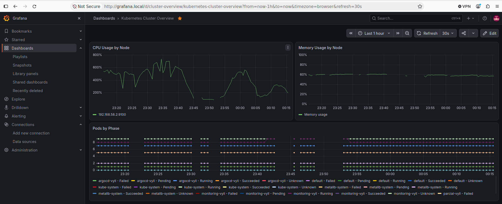

### Application Logs

The application logs dashboard is defined in `monitoring/grafana/dashboards/application-logs.json`.

It queries Loki to display logs from the four application workloads in the `parcial-vyll` namespace:

- `home`
- `about`
- `contact`
- `projects`

This dashboard demonstrates centralized log collection and querying through Loki and Grafana.

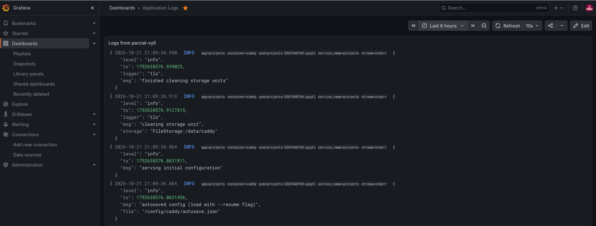


## Exposing Services Through Traefik and MetalLB

Traefik routes external HTTP requests to Grafana and Prometheus. MetalLB provides the LoadBalancer IP assigned to the Traefik service.

Configuration file: `monitoring/traefik/ingressroutes.yaml`

The local DNS configuration uses these domain names:

| Service | Local domain |
|---|---|
| Grafana | `grafana.local` |
| Prometheus | `prometheus.local` |

Both domains point to the Traefik LoadBalancer IP, `192.168.58.240`.

The local `/etc/hosts` file contains the corresponding entries:

```text
192.168.58.240 grafana.local
192.168.58.240 prometheus.local
```

Access the services through:

- Grafana: [http://grafana.local](http://grafana.local)
- Prometheus: [http://prometheus.local](http://prometheus.local)
- Prometheus Targets: [http://prometheus.local/targets](http://prometheus.local/targets)

### Traefik Ingress Routes

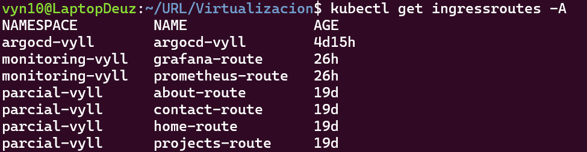

## Prometheus Targets Verification

The Prometheus Targets page shows whether configured monitoring targets are reachable and successfully scraped.

URL: [http://prometheus.local/targets](http://prometheus.local/targets)

The following screenshot provides evidence of the targets' status at the time of verification.

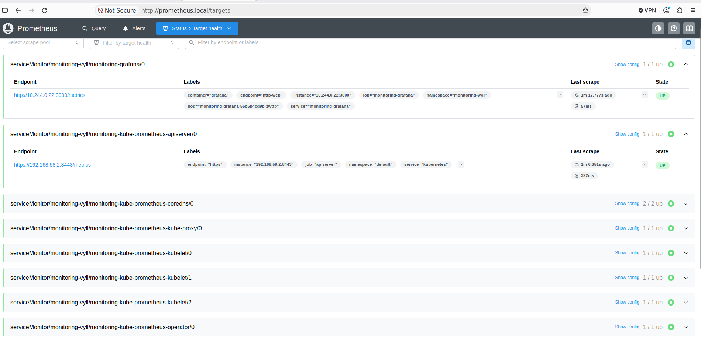

## Verification Commands

The following commands provide an overview of the deployed resources:

```bash
minikube status
kubectl get nodes -o wide
kubectl get pods -n monitoring-vyll -o wide
kubectl get pods -n parcial-vyll -o wide
kubectl get daemonsets -n monitoring-vyll
kubectl get services -n monitoring-vyll
kubectl get ingressroutes -n monitoring-vyll
kubectl get services -n traefik
```

The expected result is a healthy Minikube cluster, running monitoring components, running application workloads, and configured routes for the monitoring interfaces.

## Infrastructure as Code

The repository contains the configuration files used to define the monitoring stack, including Helm values, Kubernetes manifests, Grafana provisioning files, dashboard JSON definitions, and Traefik routing resources.

Keeping these files under version control makes the configuration easier to inspect, maintain, and reproduce.

The Git branch for this evaluation is `personal-project-01`, created from `main` as required by the assignment.

### Repository Configuration Evidence

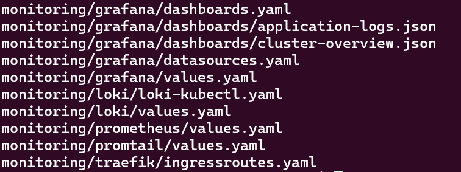
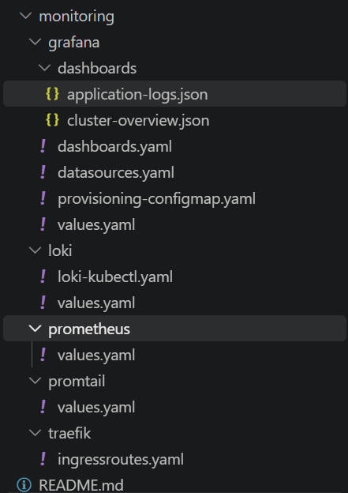

