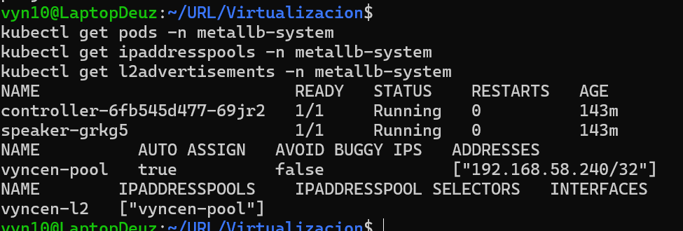
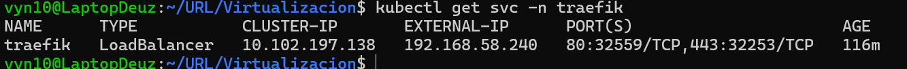
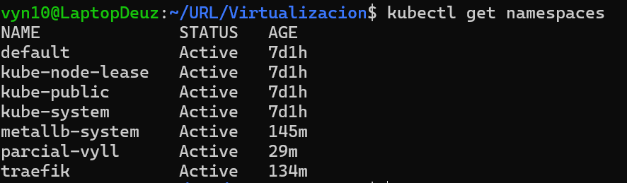
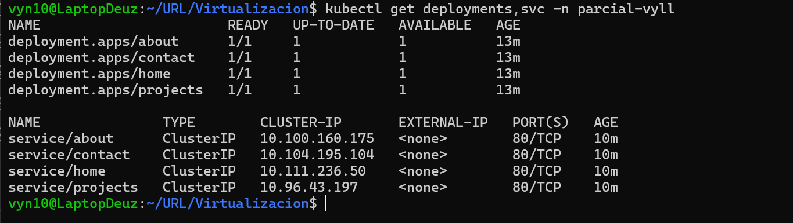
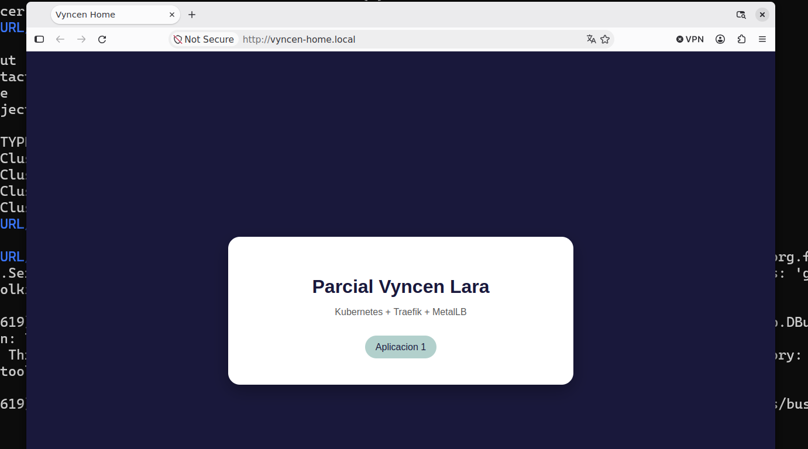
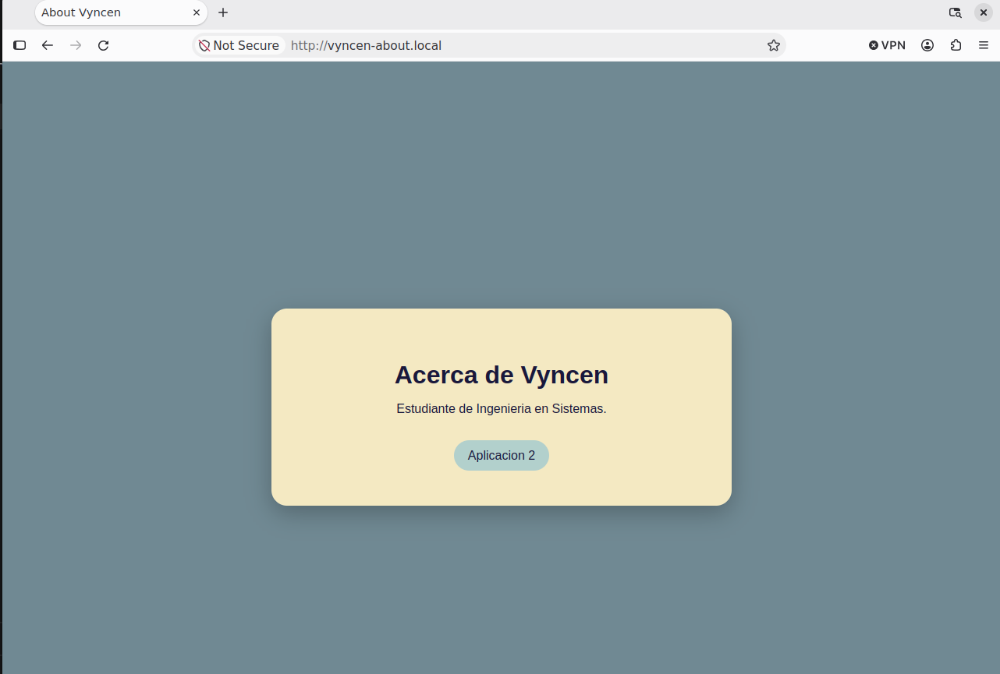
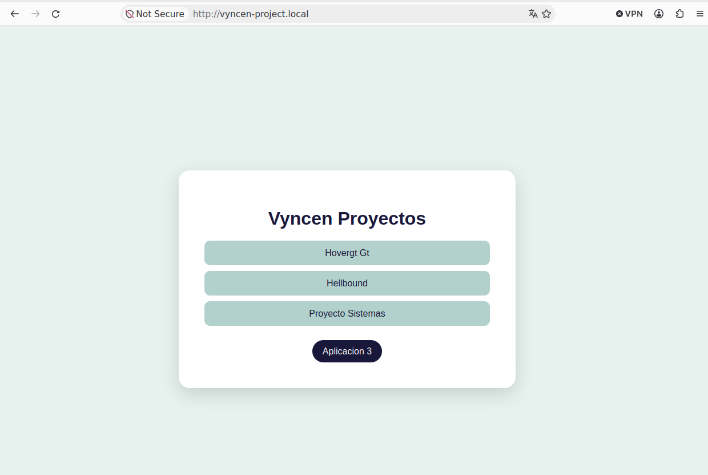
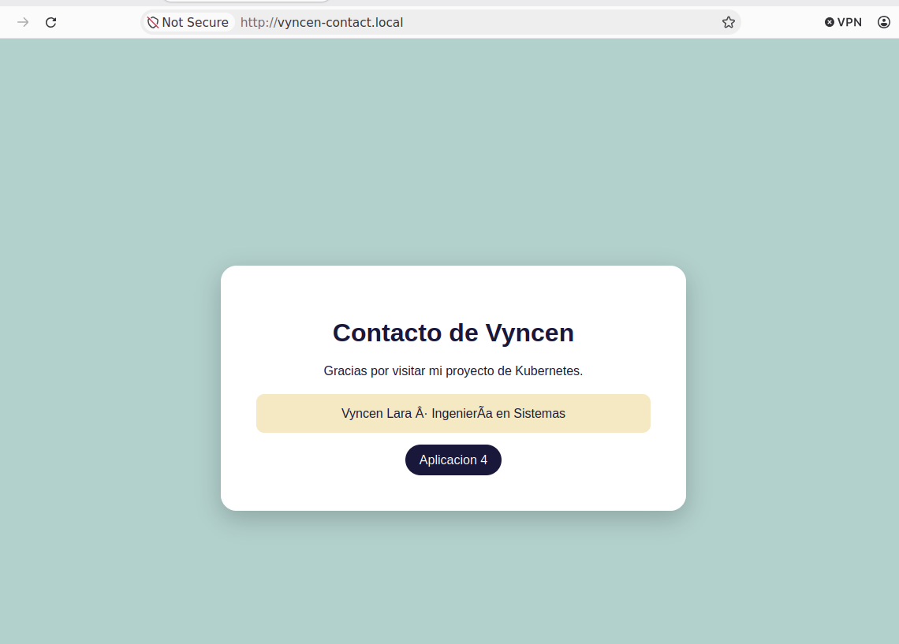

# Assessment 02

The cluster contains:

* MetalLB in the `metallb-system` namespace.
* Traefik in the `traefik` namespace.
* Four web applications in the `parcial-vyll` namespace.
* Four Kubernetes Services.
* Four Traefik IngressRoutes.
* Four local DNS records pointing to the same Traefik LoadBalancer IP.

## 1. MetalLB Configuration

MetalLB was installed in the `metallb-system` namespace.

The IP address pool was configured to provide one IP address for the Traefik LoadBalancer service.

Configuration file:

```text
k8s/metallb/ip-pool.yaml
```

The configured IP address is:

```text
192.168.58.240
```

Verification:

```bash
kubectl get pods -n metallb-system
kubectl get ipaddresspools -n metallb-system
kubectl get l2advertisements -n metallb-system
```



---

## 2. Traefik Configuration

Traefik was installed in the `traefik` namespace using the official Helm chart.

The configuration is stored in:

```text
k8s/traefik/values.yaml
```

Traefik was configured as a Kubernetes `LoadBalancer` service.

Verification:

```bash
kubectl get svc -n traefik
```

The Traefik LoadBalancer received the following IP:

```text
CLUSTER-IP: 10.102.197.138
EXTERNAL-IP: 192.168.58.240
```



---

## 3. Application Namespace

All four applications and their services were deployed in:

```text
parcial-vyll
```

This namespace was created according to the required naming convention using the initials of the student's name.



---

## 4. Applications

Four web applications were created:

| Application | Service    | Domain                 |
| ----------- | ---------- | ---------------------- |
| Home        | `home`     | `vyncen-home.local`    |
| About       | `about`    | `vyncen-about.local`   |
| Projects    | `projects` | `vyncen-project.local` |
| Contact     | `contact`  | `vyncen-contact.local` |

The applications use Nginx containers with custom HTML pages.

The Kubernetes configuration is located in:

```text
k8s/apps/
```

Verification:

```bash
kubectl get deployments,svc -n parcial-vyll
```



---

## 5. Traefik Routing

Traefik was configured using `IngressRoute` resources.

The routing configuration is stored in:

```text
k8s/apps/routes.yaml
```

The routing rules are:

```text
vyncen-home.local     -> home:80
vyncen-about.local    -> about:80
vyncen-project.local  -> projects:80
vyncen-contact.local  -> contact:80
```

Verification:

```bash
kubectl get ingressroute -n parcial-vyll
```

---

## 6. Local DNS Configuration

The following entries were added to the local hosts file:

```text
192.168.58.240 vyncen-home.local
192.168.58.240 vyncen-about.local
192.168.58.240 vyncen-project.local
192.168.58.240 vyncen-contact.local
```

All four domain names point to the same Traefik LoadBalancer IP.

---

## 7. Browser Verification

### Home

URL:

```text
http://vyncen-home.local
```



### About

URL:

```text
 firefox http://vyncen-about.local &
```



### Projects

URL:

```text
 firefox http://vyncen-project.local &
```



### Contact

URL:

```text
 firefox http://vyncen-contact.local &
```



---

## 8. Final Verification

The complete Kubernetes configuration was verified with:

```bash
kubectl get pods -n metallb-system
kubectl get pods -n traefik
kubectl get deployments,svc -n parcial-vyll
kubectl get ingressroute -n parcial-vyll
kubectl get svc -n traefik
```

All four web applications were successfully accessed through their local domain names using the single IP address assigned to the Traefik LoadBalancer.

---

## 9. Infrastructure as Code

The Kubernetes configuration is stored in YAML files:

```text
k8s/
├── metallb/
│   └── ip-pool.yaml
│
├── traefik/
│   └── values.yaml
│
└── apps/
    ├── home.yaml
    ├── about.yaml
    ├── projects.yaml
    ├── contact.yaml
    └── routes.yaml
```

This allows the Kubernetes configuration to be version controlled and reproduced using Infrastructure as Code.
