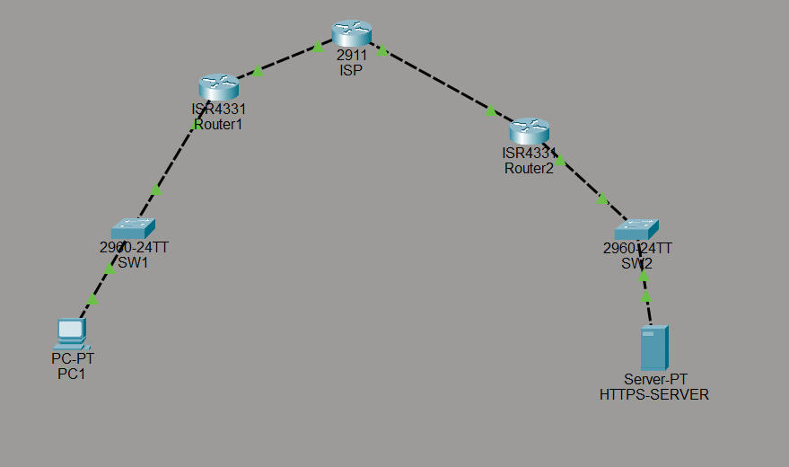
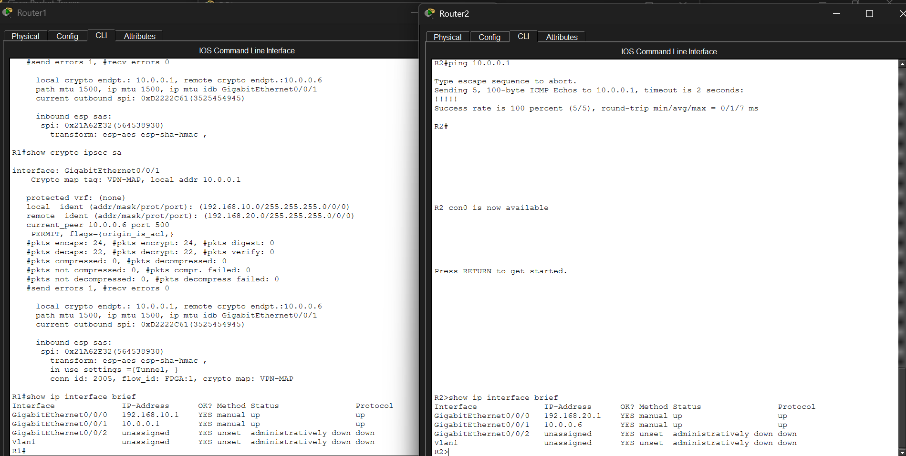
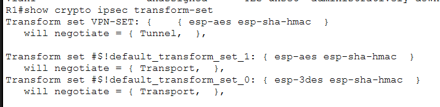
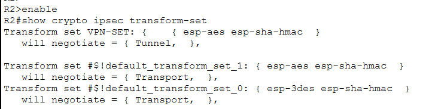
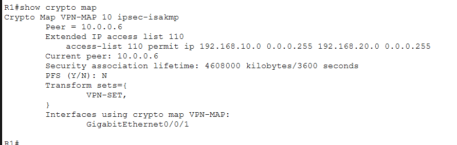
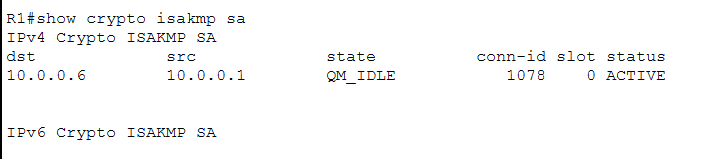
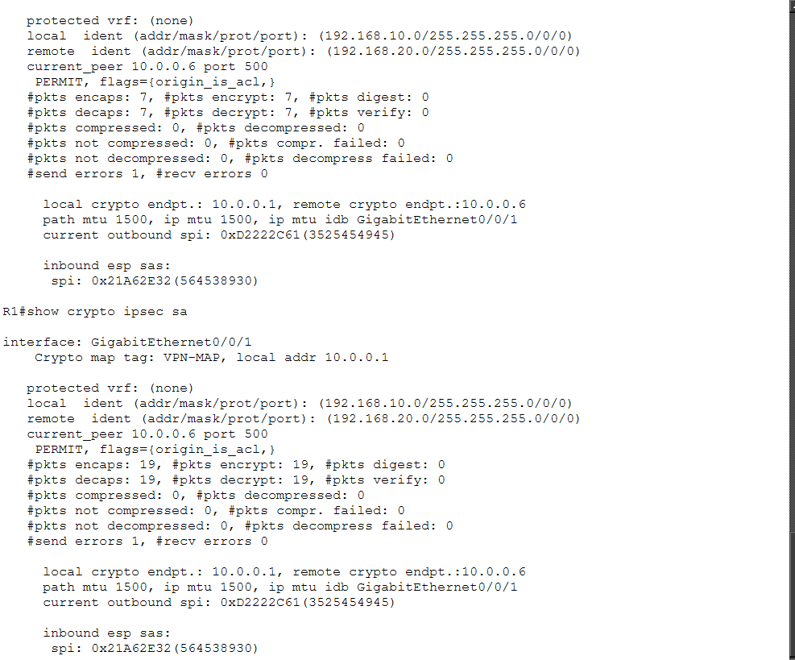
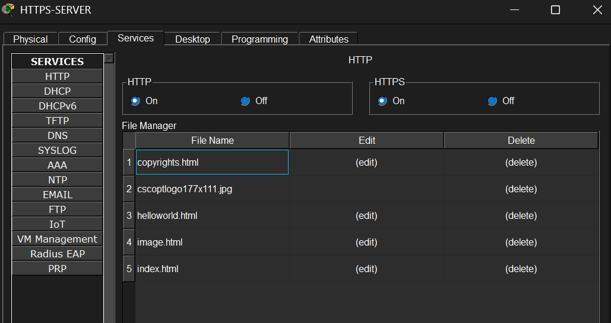
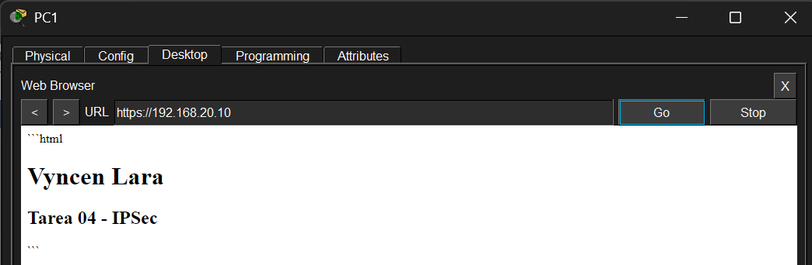

# HW-04 — IPSec and HTTPS

## Description

In this activity, an IPSec connection was configured between two different networks using an intermediate router to simulate the Internet.

The topology consists of two LANs connected through R1, an ISP router, and R2. An IPSec tunnel was established between R1 and R2 using IKE, a pre-shared key, AES encryption, SHA authentication, and Tunnel Mode.

Finally, an HTTPS web server was configured on the second network and accessed from a computer on the first network.

---

## Network Topology

The topology contains:

- LAN 1: `192.168.10.0/24`
- LAN 2: `192.168.20.0/24`
- Router1: `10.0.0.1`
- ISP: `10.0.0.2` and `10.0.0.5`
- Router2: `10.0.0.6`
- PC1: `192.168.10.10`
- HTTPS-SERVER: `192.168.20.10`

This image shows the complete Packet Tracer topology and the connection between both networks.

---

## 1. Connectivity

This image verifies the IP addressing and operational status of the router interfaces. The interfaces required for communication between the LANs and the ISP are configured and active.

---

## 2. IPSec Tunnel Mode — R1

This image shows the IPSec transform set configured on R1. The output confirms that `VPN-SET` uses AES, SHA-HMAC, and Tunnel Mode.

---

## 3. IPSec Tunnel Mode — R2

This image verifies the IPSec transform set on R2 and confirms that the VPN uses Tunnel Mode on the second endpoint.

---

## 4. Crypto Map

This image shows the `VPN-MAP` configuration, including the remote peer, the transform set, the traffic ACL, and the interface where the Crypto Map is applied.

---

## 5. IKE Security Association

This image shows the IKE Security Association between R1 and R2. The `QM_IDLE` state confirms that the IPSec negotiation was successfully established.

---

## 6. IPSec Security Association

This image shows the IPSec Security Association and the packet counters generated by traffic between the two networks, confirming that traffic is being processed through IPSec.

---

## 7. HTTPS Server

This image shows the web server configuration with HTTPS enabled on the server located in the `192.168.20.0/24` network.

---

## 8. HTTPS Request

This image shows the HTTPS request made from PC1 to `https://192.168.20.10` and the response returned by the remote web server.

---
