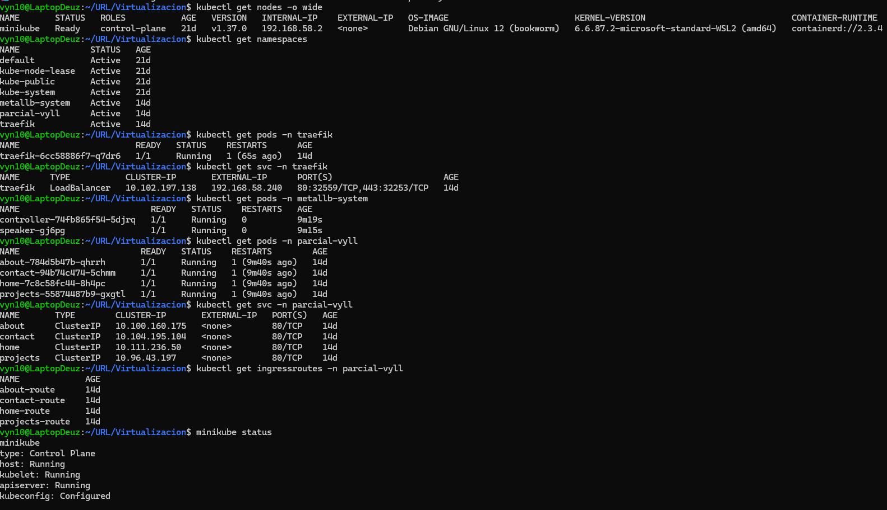
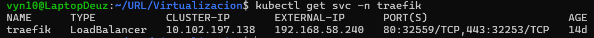
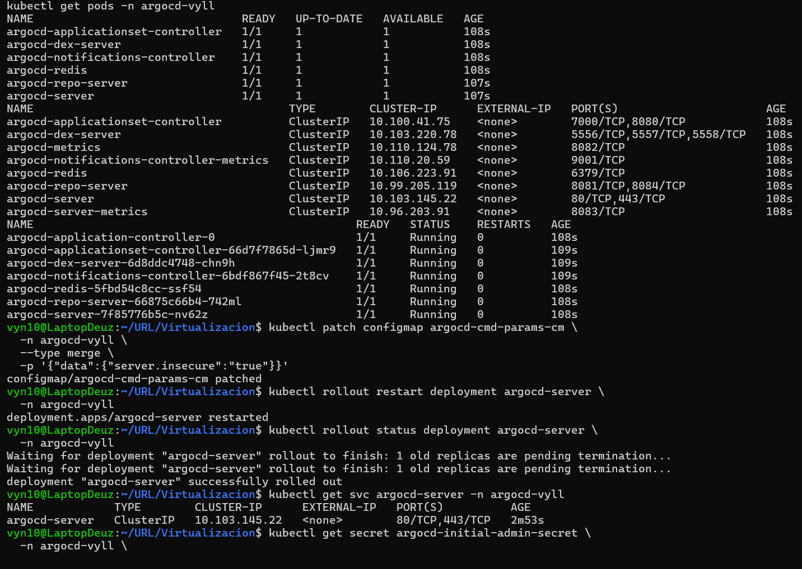
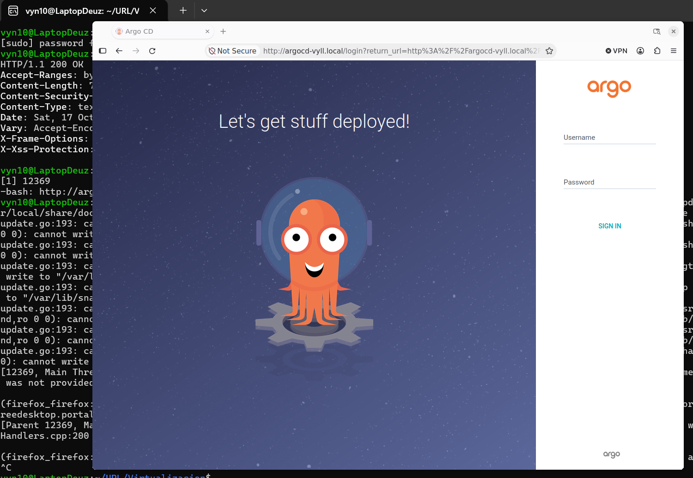
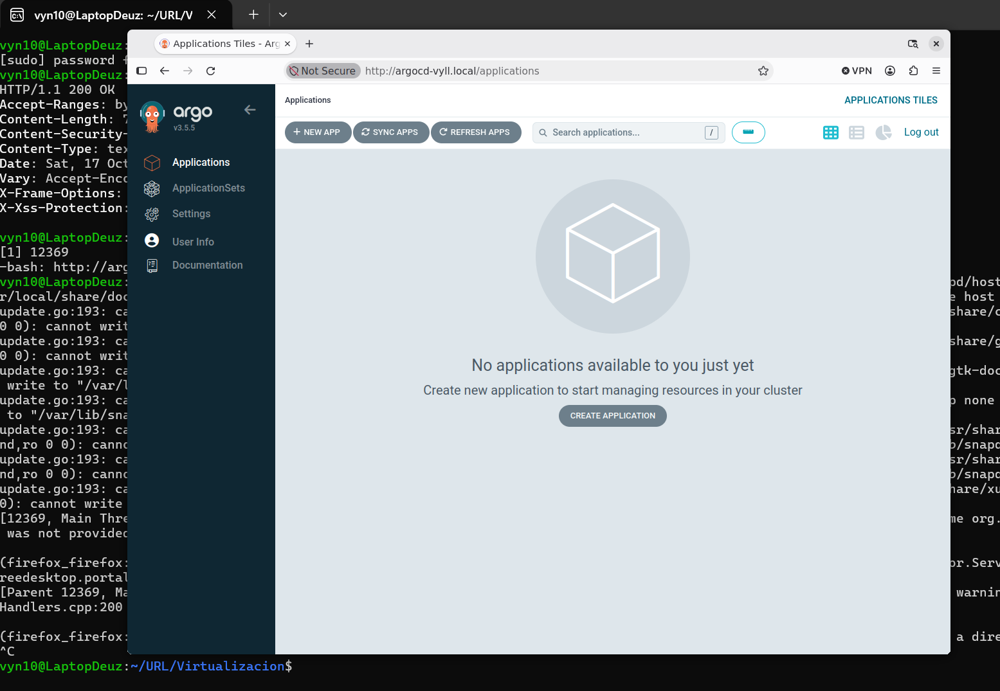
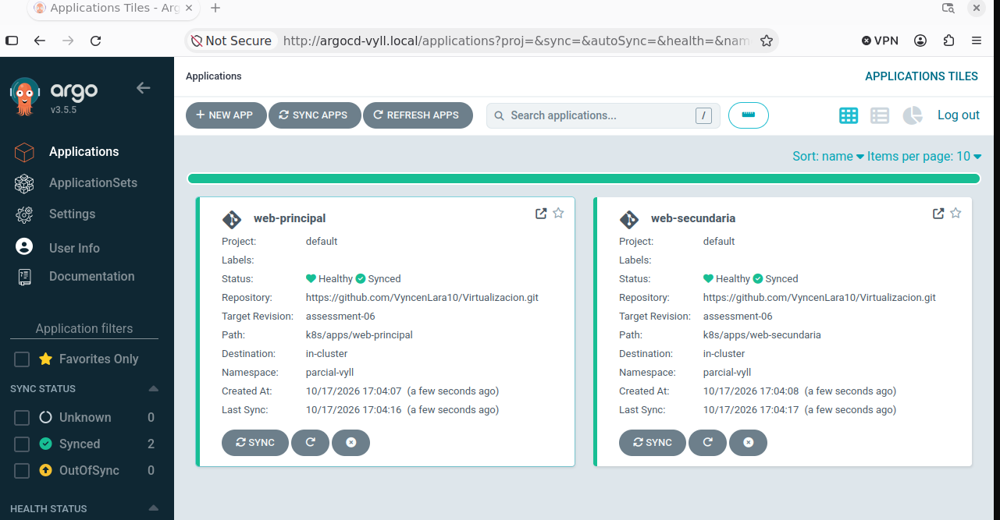
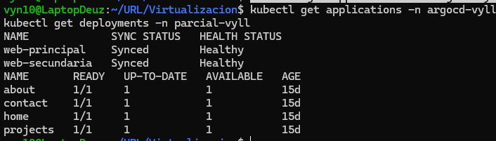
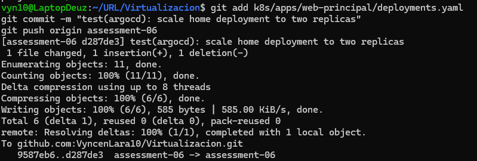
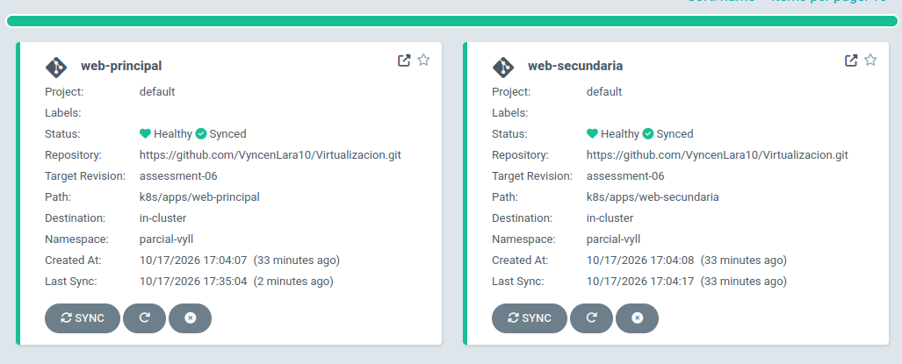
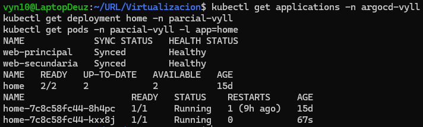

# Assessment 06

## Environment

- Kubernetes running on Minikube.
- MetalLB for LoadBalancer services.
- Traefik as the ingress controller.
- Argo CD installed in the `argocd-vyll` namespace.
- Applications deployed in the `parcial-vyll` namespace.
- GitHub repository: `VyncenLara10/Virtualizacion`.
- Git branch: `assessment-06`.

### Initial Cluster Status




## Installation and Configuration

Argo CD was installed using the Kubernetes manifests located in `k8s/argocd/install.yaml`.

The web interface was exposed through Traefik using the IngressRoute defined in `k8s/argocd/ingressroute.yaml`. A local domain was configured to access the interface through a web browser.

### Argo CD Installation



### Web Interface Access



### Argo CD Dashboard



## Applications

Two Argo CD Applications were created to manage four web applications.

### web-principal

Manages the following applications:

- `home`
- `about`

Manifest directory: `k8s/apps/web-principal/`

### web-secundaria

Manages the following applications:

- `projects`
- `contact`

Manifest directory: `k8s/apps/web-secundaria/`

The Argo CD Application definitions are stored in:

- `k8s/argocd/applications/web-principal.yaml`
- `k8s/argocd/applications/web-secundaria.yaml`

Both applications use the GitHub repository, the `assessment-06` branch, and the `parcial-vyll` destination namespace. Automated synchronization is enabled.

## Synchronization Test

Initially, both applications reported `Synced` and `Healthy` status.

### Initial Application Status

The following screenshots show the applications before the Git change.






### Applying a Change Through GitHub

To test automated synchronization, the desired replica count for the `home` Deployment was changed from one to two in `k8s/apps/web-principal/deployments.yaml`.



The change was committed and pushed to the `assessment-06` branch in GitHub. Argo CD synchronized the updated configuration with the Kubernetes cluster.

### Results After Synchronization

**web-principal**



**home Deployment with two replicas**



The results were verified using the following commands:

```bash
kubectl get applications -n argocd-vyll
kubectl get deployment home -n parcial-vyll
```

The final results were:

- `web-principal`: `Synced` and `Healthy`.
- `web-secundaria`: `Synced` and `Healthy`.
- `home` Deployment: two desired replicas and two available replicas.
