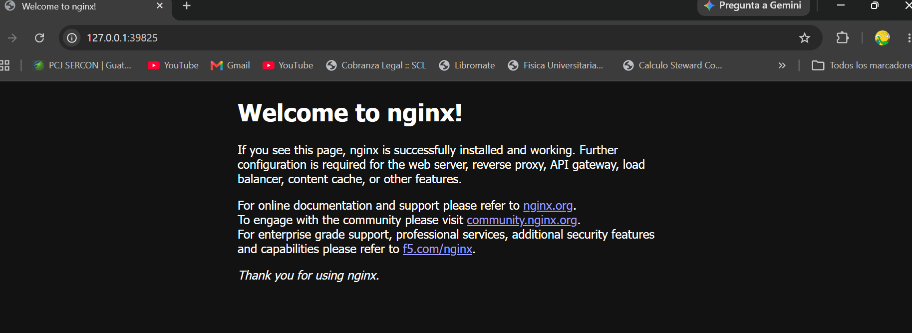
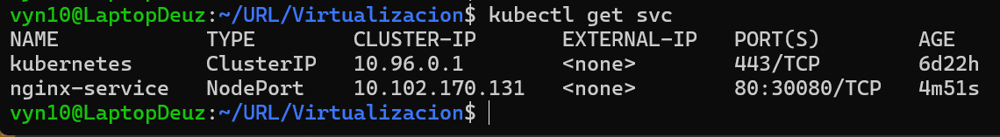

# HW-05 

## Kubernetes Configuration

The deployment configuration is located in:

* `k8s/nginx-deployment.yaml`
* `k8s/nginx-service.yaml`

The Nginx container uses port `80`.

The Kubernetes Service uses the `NodePort` type and exposes Nginx through port `30080`.

## Nginx Service

## Kubernetes Service Output

## Verification

kubectl apply -f k8s/nginx-deployment.yaml
kubectl apply -f k8s/nginx-service.yaml

The Nginx service was accessed locally using:

minikube service nginx-service --url
